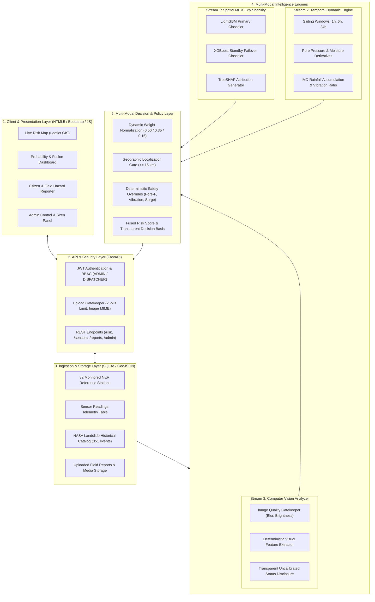

# TerraWatch NER - System Architecture & Engineering Specification

**Course Context:** Intelligent Model Design using AI (IMDAI)  
**System Type:** Multi-Modal AI Research Prototype for Landslide Risk Assessment  
**Concept Inspiration:** North Eastern Region (NER) Landslide Monitoring Problem Statement  

---

## 1. System Overview

TerraWatch NER is an academic multi-modal artificial intelligence prototype engineered for landslide hazard assessment and early warning decision-support in the North Eastern Region of India. The system bridges three distinct sensory and computational domains:

1. **Spatial Susceptibility:** Tree-based ensemble learning (LightGBM + XGBoost) predicting spatial hazard probability from terrain, geological proximity, and weather features, explained via local TreeSHAP attributions.
2. **Temporal Geotechnical Dynamics:** Multi-window temporal analysis (1-hour, 6-hour, and 24-hour sliding horizons) tracking rates of change in soil moisture, pore-water pressure, and micro-seismic vibration anomalies.
3. **Computer Vision Hazard Evidence:** Deterministic image quality checking and visual feature analysis assessing field hazard reports without fabricating uncalibrated model confidences.
4. **Multi-Modal Decision Fusion:** A mathematically grounded fusion layer combining spatial, temporal, and localized visual streams with operational weights and life-safety overrides.

---

## 2. End-to-End System Architecture

---

## 3. Subsystem Breakdown

### 3.1. Spatial Intelligence & TreeSHAP Layer (`ml_service.py`)
- **Primary Active Model:** `best_landslide_model.joblib` (LightGBM Classifier).
- **Standby Model:** `standby_landslide_model.joblib` (XGBoost Classifier).
- **Consensus & Failover:** Parallel execution compares probability outputs to compute `ensemble_agreement_pct`. If LightGBM fails, the engine seamlessly fails over to XGBoost.
- **Explainability:** Implements TreeSHAP to calculate exact Shapley values $\phi_i$ for each input feature, extracting top positive drivers to justify risk predictions.

### 3.2. Temporal Sensor Dynamic Engine (`temporal_service.py`)
- **Sliding-Window Aggregator:** Reconstructs 1h, 6h, and 24h analytical windows from database telemetry.
- **Physical Rate Derivatives:**
  - Pore-water pressure derivative ($\Delta P / \Delta t$) and critical threshold check ($28.0\text{ kPa}$).
  - Volumetric soil moisture rise rate ($\Delta \theta / \Delta t$) and saturation acceleration.
  - Micro-seismic vibration anomaly ratio ($\text{Current} / \text{Baseline}$).
  - Antecedent rainfall accumulation according to IMD classification criteria.
- **Data Sufficiency Check:** Requires historical data spanning windows; flags partial datasets to prevent false confidence.

### 3.3. Computer Vision Hazard Analyzer (`cv_service.py`)
- **Quality Verification:** Analyzes brightness, contrast, and Laplacian variance (blur detection) before inference.
- **Deterministic Feature Extraction:** Evaluates edge density (cracks/fissures), soil chroma saturation, and structural disruption.
- **Scientific Integrity:** Strictly sets `confidence = None` and reports `scientific_status = "uncalibrated_unvalidated"` because the repository does not have a labeled landslide training dataset.

### 3.4. Multi-Modal Risk Fusion Engine (`fusion_service.py`)
- **Mathematical Formula:**
  $$\text{Fused Risk Score} = \sum_{m \in \{S, T, V\}} w_m \cdot x_m$$
  where weights are dynamically renormalized if temporal sensors or visual reports are absent for a station.
- **Geospatial Localization Gate:** Citizen field images are only fused into a station if captured within $\le 15.0\text{ km}$ of the monitored station coordinates.
- **Safety Overrides:** Deterministic life-safety rules that elevate the risk tier to `CRITICAL` regardless of low spatial or visual scores:
  - Pore-water pressure $\ge 28.0\text{ kPa}$
  - Ground vibration $\ge 0.5\text{ g}$ or ratio $\ge 3.0\times$ baseline
  - Temporal risk index $\ge 80.0$
  - Spatial model probability $\ge 0.90$

---

## 4. Security & Hardening Architecture

1. **JWT Secret Management:**
   - `SECRET_KEY` is strictly required from environment variables or `.env`.
   - Hardcoded fallbacks are removed; system immediately halts if the secret is absent.
2. **Role-Based Access Control (RBAC):**
   - Protected endpoints require Bearer tokens with validated claims.
   - Global threshold modifications (`/api/admin/settings`) require `ADMIN` role.
   - Siren activation (`/api/alerts/sirens/trigger`) records triggering user identity for audit trails.
3. **Payload & File Upload Protection:**
   - File uploads enforced strictly $\le 25\text{ MB}$.
   - Extension and MIME-type verification prevents arbitrary code execution.
4. **Data Authenticity:**
   - All artificial floors (`max(..., 15)`) and synthetic constant fallbacks in `/api/admin/dashboard` are removed. Metrics reflect live database queries.

---

## 5. Scientific Provenance Classification System

To maintain academic rigor, all data points across TerraWatch NER are categorized using a 5-tier provenance taxonomy:

| Tier | Classification | Definition | Application in TerraWatch NER |
| :---: | :--- | :--- | :--- |
| **A** | External Authoritative Dataset | Published, verified ground-truth from recognized scientific bodies. | NASA Global Landslide Catalog (351 NER historical events). |
| **B** | Computationally Derived Data | Calculated programmatically from authoritative source inputs. | Derived temporal derivatives, TreeSHAP Shapley values. |
| **C** | Engineering / Demo Heuristic | Documented operational rules for prototype demonstration. | Simulator scenario values, fusion weighting policy thresholds. |
| **D** | Estimated / Assumed Baseline | Plausible heuristic baseline without verified ground survey. | 32 station terrain attributes (elevation, slope, lithology). |
| **E** | Synthetic / Generated Data | Algorithmically synthesized data for software benchmarking. | 7,000 ML training samples, simulated IoT sensor telemetry. |
