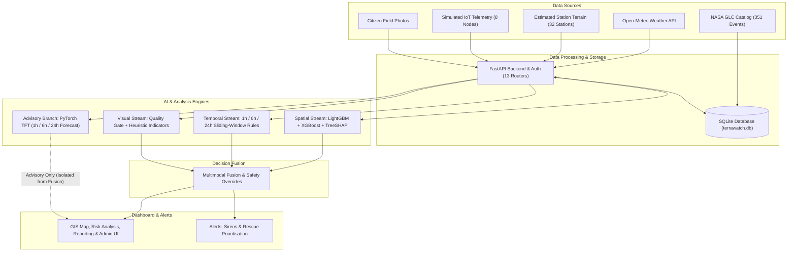

# TerraWatch NER

**Academic Multi-Modal AI Landslide Risk Monitoring & Forecasting Prototype**  
Developed for the **Intelligent Model Design using AI (IMDAI)** course, inspired by landslide hazard challenges in the **North Eastern Region (NER)** of India.

> **Important Notice:** TerraWatch NER is an **academic research prototype**, not an operational government early warning system. Classification models are trained on a synthetic dataset (7,000 samples), IoT sensor telemetry is simulated, and station terrain attributes are estimated heuristic baselines. Reported accuracy and forecast metrics do not establish verified real-world landslide prediction performance.

---

## Project Overview

**TerraWatch NER** is a web-based decision-support prototype designed to assess and monitor landslide risk across the eight states of North-East India (Arunachal Pradesh, Assam, Manipur, Meghalaya, Mizoram, Nagaland, Sikkim, and Tripura). Heavy monsoon rainfall, steep slopes, and fragile geology make the region highly vulnerable to sudden slope failures that disrupt roads and endanger communities. The system combines machine learning classification (LightGBM and XGBoost), rule-based temporal sensor analysis, a Temporal Fusion Transformer (TFT) for short-term subsurface forecasting, and deterministic visual hazard checks into a single GIS dashboard to assist researchers, evaluators, and emergency planners in exploring multi-modal risk assessment.

---

## Key Features

- **Interactive Landslide Risk Assessment:** Computes station-level and custom-parameter risk scores with plain-language contributing factors and safety recommendations.
- **Interactive GIS Risk Map:** Displays 32 monitored reference stations across 8 NER states alongside emergency shelters, rescue points, and State Emergency Operations Centres (SEOCs) with state-level filtering.
- **Spatial Machine Learning Predictions:** Uses a primary LightGBM classifier and a standby XGBoost failover classifier across 20 terrain, meteorological, and geotechnical features.
- **Temporal Sensor Analysis:** Evaluates 1-hour, 6-hour, and 24-hour sliding windows for pore-water pressure, soil moisture rise rates, vibration anomalies, and rainfall accumulation.
- **TFT Subsurface Forecasting (Advisory):** Uses a PyTorch Temporal Fusion Transformer to forecast soil moisture and pore-water pressure at 1h, 6h, and 24h horizons with 10th–90th percentile confidence bands.
- **TreeSHAP Explainability:** Extracts local Shapley attributions from tree models to show which features (such as rainfall, slope, or soil moisture) drove each risk prediction.
- **Computer Vision Hazard Assessment:** Validates citizen-uploaded field photos for image quality (resolution, blur, brightness) and computes deterministic visual indicators (edge density, soil chroma) labeled explicitly as uncalibrated heuristics.
- **Multimodal Risk Fusion & Safety Overrides:** Combines spatial, temporal, and localized visual evidence streams using adaptive weights and deterministic life-safety override rules.
- **Emergency Assistance & Rescue Prioritisation:** Ranks emergency tasks using a weighted priority formula combining severity, exposed population, and exposed roads.
- **Citizen Hazard Reporting & Offline Sync:** Provides a 4-step reporting form with photo upload and an offline queue (`offline-sync.js`) that synchronizes when connectivity returns.
- **IoT Sensor Simulation:** Includes a configurable telemetry generator simulating 8 regional sensor nodes across normal and extreme hazard scenarios.
- **Administrative Controls:** Offers role-based access (JWT authentication) for viewing diagnostics, historical events, sensor streams, and simulated emergency siren triggers.

---

## Data Sources

| Data Source | Data Collected | Used By | Real or Simulated |
| :--- | :--- | :--- | :--- |
| **NASA Global Landslide Catalog (GLC)** | 351 historical NER landslide records (coordinates, dates, triggers, casualties) | Historical catalog API & admin diagnostics | Real (Authoritative external catalog) |
| **Open-Meteo Weather API** | Live temperature, humidity, 24h/72h precipitation, weather codes (with regional fallback) | Runtime spatial inference & GIS map | Real (Live external API) / Fallback baseline |
| **Station Geospatial & Terrain Profiles** | Coordinates, population/roads exposed, and 13 terrain/geology attributes for 32 NER stations | GIS map & runtime inference defaults | Coordinates: Real; Terrain attributes: Estimated |
| **Synthetic Landslide Dataset** | 7,000 tabular samples across 20 input features and binary landslide labels | Spatial ML training & benchmarking | Simulated (Programmatically generated) |
| **Simulated IoT Sensor Telemetry** | Time-stamped soil moisture, pore pressure, vibration, and temperature for 8 nodes | Temporal analyzer & TFT forecasting | Simulated (`sensor_simulator.py` & 1,200h series) |
| **Citizen-Uploaded Photographs** | Field hazard images uploaded through the reporting form | Computer vision analyzer & triage | User-uploaded at runtime |

**Training Data vs. Runtime Inference Data:**  
The spatial ML models (LightGBM and XGBoost) are trained offline on the 7,000-sample synthetic dataset (`backend/data/ner_landslide_dataset.csv`), while the TFT model is trained offline on a calibrated 50-day (1,200-hour) simulated hourly time series across 8 station nodes. At runtime, the system does **not** retrain; instead, it combines live Open-Meteo weather (or user-entered scenario sliders), estimated station terrain profiles, simulated database sensor readings, and optional uploaded photos to compute live risk assessments.

---

## Synthetic Dataset Generation

Because no unified, labeled multi-sensor geotechnical dataset exists for all 8 NER states, the spatial classification dataset (7,000 samples) is generated programmatically by `ml_pipeline/training/train_models.py`:

- **Regional Parameterization:** Samples are drawn across 18 representative NER districts spanning all 8 states, each assigned base elevation, tectonic factors, and monsoon multipliers.
- **Statistical Distributions:** Terrain and proximity features are sampled using domain-inspired distributions (Beta distribution for slope angles, Exponential distributions for road/fault/stream distances, and uniform/weighted sampling for aspect, NDVI, lithology, soil type, and land use).
- **Monsoon vs. Non-Monsoon Regimes:** 35% of samples represent monsoon conditions (Gamma-distributed 24h rainfall, higher antecedent 72h rainfall, elevated soil moisture 45–98%, and pore pressure 2–42 kPa), while 65% represent non-monsoon conditions (lower exponential rainfall, moisture 10–58%, pore pressure 0.5–12 kPa).
- **Physics-Inspired Instability & Labeling:** Driving forces (slope sine, pore pressure, road cuts, tectonic factor) and resisting forces (friction angle, vegetation NDVI, lithology/soil/land-use vulnerability) are combined with rainfall triggers into an instability index, passed through a logistic sigmoid with small Gaussian noise, and thresholded at `prob >= 0.50` to produce binary landslide labels.
- **Train/Test Split:** Stratified 80% training (5,600 samples) and 20% testing (1,400 samples) split.

Detailed equations and feature definitions are documented in [MODEL_EVALUATION.md](MODEL_EVALUATION.md).

---

## AI Models

| Model | Input Data | Output | Purpose |
| :--- | :--- | :--- | :--- |
| **LightGBM Classifier** | 20 tabular terrain, weather, and sensor features | Landslide probability (`0.0–1.0`) | Primary active spatial susceptibility classifier |
| **XGBoost Classifier** | 20 tabular terrain, weather, and sensor features | Landslide probability (`0.0–1.0`) | Standby failover classifier & consensus check |
| **Temporal Fusion Transformer (TFT)** | 24h observed sensor history + static station metadata + known time features | Multi-quantile (`p10`, `p50`, `p90`) 1h/6h/24h forecasts for soil moisture & pore pressure | Independent advisory subsurface forecasting |

- **Primary Classification Model (LightGBM):** A histogram-based gradient-boosted tree pipeline selected for its high recall (98.04%), ROC-AUC (0.9961), and sub-15 ms inference speed.
- **Standby Classification Model (XGBoost):** Runs in parallel with LightGBM to compute an ensemble agreement percentage and automatically serves predictions if the primary model fails.
- **Future-Condition Forecasting Model (TFT):** A PyTorch implementation of the Temporal Fusion Transformer (97,704 parameters) trained offline with strict chronological 70/15/15 splits. It operates in **advisory mode** and does not alter operational risk tiers or trigger sirens.
- **Explainability (TreeSHAP):** TreeSHAP is **not** a separately trained model; it is an attribution method applied directly to the LightGBM/XGBoost trees at inference time to quantify each feature's log-odds contribution.
- **Rule-Based & Heuristic Components:**
  - **Computer Vision Module (`cv_service.py`):** Operates as a deterministic visual quality gate and heuristic feature analyzer (`confidence = None`, `HEURISTIC_NOT_VALIDATED`) because no labeled landslide image training dataset is included.
  - **Temporal Analyzer, Multimodal Fusion, & Rescue Prioritisation:** Use documented rule-based sliding windows, weighted linear combinations, and threshold checks.

---

## System Architecture



---

## How the Project Works

1. **Data Ingestion:** The backend collects live weather from Open-Meteo (cached for 30 minutes), loads estimated terrain profiles for 32 NER stations, and receives simulated IoT sensor readings every few seconds.
2. **Spatial Risk Inference:** LightGBM (and standby XGBoost) evaluates 20 terrain, weather, and sensor features to estimate spatial susceptibility, while TreeSHAP identifies the top driving factors.
3. **Temporal Trend Analysis:** The temporal engine examines recent sensor readings over 1h, 6h, and 24h windows to detect rising soil moisture, pore-water pressure buildup, or vibration spikes.
4. **Visual Evidence Check (Optional):** When a citizen or field officer uploads a photo within 15 km of a station, the computer vision module checks image quality and assigns a qualitative visual evidence strength.
5. **Multimodal Fusion & Safety Check:** The fusion engine combines available spatial, temporal, and visual scores and checks whether critical safety thresholds are breached.
6. **Advisory Subsurface Forecasting:** Independently, the TFT model processes the last 24 hours of hourly sensor history to project soil moisture and pore-water pressure 1h, 6h, and 24h ahead.
7. **Visualization & Alerts:** The dashboard displays interactive map markers, risk percentages, explanations, TFT forecast charts, rescue priorities, and simulated emergency alerts.

---

## Risk Calculation

The operational risk score is produced by `RiskFusionEngine` (`backend/app/services/fusion_service.py`) on a normalized `0.0–1.0` scale (displayed in the UI as `Math.round(score * 100)%` for fused scores and `round(prob * 100, 1)` in raw spatial API responses).

### Adaptive Fusion Weights

| Available Evidence Streams | Spatial Weight | Temporal Weight | Visual Weight |
| :--- | :---: | :---: | :---: |
| **Spatial + Temporal + Localized Visual ($\le 15\text{ km}$)** | `0.50` | `0.35` | `0.15` |
| **Spatial + Temporal (No localized visual)** | `0.60` | `0.40` | `0.00` |
| **Spatial + Localized Visual (Temporal unavailable)** | `0.80` | `0.00` | `0.20` |
| **Spatial Only** | `1.00` | `0.00` | `0.00` |

### Risk Classification Tiers

| Normalized Fused Score | Risk Tier |
| :---: | :--- |
| `< 0.35` | **LOW** |
| `0.35 – 0.549` | **MODERATE** |
| `0.55 – 0.749` | **HIGH** |
| `>= 0.75` | **CRITICAL** |

### Safety Overrides & Why 80% Appears Frequently

Before finalizing the operational tier, the fusion engine checks five deterministic safety override rules:
1. Pore-water pressure $\ge 25.0\text{ kPa}$
2. Ground vibration $\ge 1.5\text{ g}$ **or** vibration anomaly ratio $\ge 4.0\times$ baseline
3. Temporal hazard score $\ge 85.0$
4. Spatial ML probability $\ge 0.85$
5. Localized visual evidence of `HIGH` `landslide_debris`

- **Calculated Risk vs. Operational Risk:** `calculated_fused_score` is the raw weighted sum of the available streams. If any safety override triggers, the tier is immediately forced to `CRITICAL`, and the **operational** `fused_risk_score` is set to `max(calculated_fused_score, 0.80)`.
- **Reason for Repeated 80% Scores:** Whenever an override (such as high pore pressure or high vibration) triggers while the weighted average is still below `0.80`, this `0.80` safety floor clamps the displayed operational risk to **80%**.

> **Calibration Note:** These risk scores and fusion indices are heuristic decision-support indicators, **not** scientifically calibrated real-world event probabilities.

---

## Model Performance

### Spatial Classification Benchmark (7,000 Synthetic Samples, 80/20 Split)

Results recorded in `backend/models/benchmark_results.csv` and `backend/models/best_model_metadata.json`:

| Model | Accuracy | Precision | Recall | F1-Score | ROC-AUC | Training Time | Role |
| :--- | :---: | :---: | :---: | :---: | :---: | :---: | :--- |
| **LightGBM Classifier** | **97.00%** | **97.40%** | **98.04%** | **0.9772** | **0.9961** | 0.22 s | **Primary Active** |
| **Gradient Boosting (GBDT)** | 96.93% | 97.09% | 98.26% | 0.9767 | 0.9936 | 7.15 s | Benchmarked |
| **XGBoost Classifier** | **96.93%** | **97.50%** | **97.82%** | **0.9766** | **0.9961** | 0.65 s | **Standby Failover** |
| **Logistic Regression** | 96.86% | 97.39% | 97.82% | 0.9761 | 0.9955 | 0.07 s | Linear Baseline |
| **Random Forest Classifier** | 95.00% | 97.11% | 95.20% | 0.9615 | 0.9918 | 0.45 s | Benchmarked |
| **Decision Tree** | 93.00% | 93.61% | 95.86% | 0.9472 | 0.9624 | 0.09 s | Tree Baseline |

**Model Selection Criterion:** Models are ranked by a weighted **Composite Disaster Score** (`0.35 * Recall + 0.30 * ROC-AUC + 0.20 * F1 + 0.15 * PR-AUC`). LightGBM achieved the highest composite score (`0.9871` vs. `0.9867` for GBDT and `0.9862` for XGBoost) while training in `0.22 s`.

### TFT Subsurface Forecasting Benchmark (Simulated Hourly Telemetry)

Results recorded in `backend/models/tft/tft_metadata.json` on the chronological test split:

| Target Variable | Horizon | TFT MAE | TFT RMSE | Persistence MAE | Persistence RMSE | 24h Moving Avg MAE |
| :--- | :---: | :---: | :---: | :---: | :---: | :---: |
| **Soil Moisture (%)** | **1h** | **1.088** | **2.261** | 1.441 | 3.097 | 10.387 |
| | **6h** | **1.519** | **4.059** | 7.732 | 13.514 | 13.365 |
| | **24h** | **2.191** | **4.327** | 19.783 | 25.742 | 19.937 |
| **Pore Pressure (kPa)** | **1h** | **0.797** | **1.775** | 1.072 | 3.131 | 11.316 |
| | **6h** | **1.155** | **3.453** | 6.499 | 12.622 | 16.018 |
| | **24h** | **2.567** | **5.705** | 25.612 | 30.980 | 27.455 |

> **Important:** Both the classification benchmarks and TFT forecast metrics are derived from synthetic and simulation-based datasets. They demonstrate software behavior and relative model ranking, **not** verified real-world landslide prediction accuracy.

---

## Technology Stack

| Layer | Technologies Used |
| :--- | :--- |
| **Frontend** | HTML5, CSS3, Bootstrap 5.3.3, Bootstrap Icons, Vanilla JavaScript, Chart.js |
| **Backend** | Python 3.12, FastAPI, Uvicorn, Pydantic v2, PyJWT, bcrypt |
| **AI / Machine Learning** | LightGBM, XGBoost, scikit-learn, PyTorch (native TFT), NumPy, pandas, joblib |
| **Database** | SQLite (`terrawatch.db`) with SQLAlchemy 2.0 ORM |
| **GIS & Mapping** | Leaflet.js, OpenStreetMap tiles, GeoJSON, Shapely |
| **Weather Integration** | Open-Meteo Forecast API (`requests` with 30-minute in-memory TTL cache) |
| **Testing** | pytest, FastAPI `TestClient`, httpx |

---

## Installation and Setup

> **Note:** This GitHub repository is private. Authorized GitHub access is required to clone it.

### 1. Clone the Repository
```powershell
git clone https://github.com/yoogy-srinivash/terra-watch-NER.git
cd terra-watch-NER
```

### 2. Create Virtual Environment and Install Dependencies
```powershell
python -m venv venv
.\venv\Scripts\activate
pip install -r requirements.txt
```
*(Use the root `requirements.txt`, which includes PyTorch for the TFT forecasting service.)*

### 3. Configure Environment Variables
Copy `.env.example` to `.env` and set your own `SECRET_KEY` (required by `backend/app/config.py`; the application will not start without it):
```powershell
copy .env.example .env
```
Edit `.env` to provide a strong random `SECRET_KEY` and any optional notification settings.

### 4. Start the Application

**Option A: Windows One-Click Launchers**
- Double-click `start_all.bat` to launch the backend, browser UI, and optional sensor simulator.
- Individual launchers are also available: `run_backend.bat`, `run_frontend.bat`, `run_sensor_sim.bat`, and `run_tests.bat`.

**Option B: Manual Commands**
1. **Start the Backend:**
   ```powershell
   .\venv\Scripts\python.exe -m uvicorn backend.app.main:app --host 0.0.0.0 --port 8000 --reload
   ```
2. **Open the Frontend:**
   Navigate to `http://localhost:8000/ui/index.html` (or `http://localhost:8000/docs` for the OpenAPI specification).
3. **Run the Sensor Simulator (Optional):**
   ```powershell
   .\venv\Scripts\python.exe sensor_simulator/sensor_simulator.py --backend-url http://localhost:8000 --interval 5
   ```
4. **Run Automated Tests:**
   ```powershell
   .\venv\Scripts\python.exe -m pytest backend/tests/ -v
   ```

*(Evaluation role accounts are seeded locally by `backend/data/seed_data.py` and accessible via quick-login buttons on `ui/login.html` for local demonstrations.)*

---

## Project Structure

```text
terra-watch-NER/
├── alerts_explainability/     # Risk level mapping, alert messages, and recommendations
├── backend/
│   ├── app/
│   │   ├── models/            # 20 SQLAlchemy ORM models
│   │   ├── routers/           # 13 FastAPI REST API routers (incl. forecasting)
│   │   ├── schemas/           # Pydantic validation schemas
│   │   ├── services/          # ML, TFT, Temporal, CV, Fusion, GIS, Weather, Emergency services
│   │   ├── utils/             # JWT auth, bcrypt hashing, audit logging
│   │   ├── config.py          # Environment & threshold settings
│   │   └── main.py            # FastAPI entrypoint & static UI/GIS mounting
│   ├── data/                  # Synthetic dataset CSV & database seeding script
│   ├── models/                # Saved LightGBM, XGBoost, and PyTorch TFT checkpoints & metadata
│   └── tests/                 # 7 pytest test suites (71 tests)
├── gis/                       # 32 monitored NER station coordinates & baseline profiles
├── ml_pipeline/
│   ├── data_ingestion/        # NASA Global Landslide Catalog loader
│   ├── temporal_forecasting/  # PyTorch TFT architecture & offline training pipeline
│   └── training/              # Synthetic dataset generator & 6-model benchmark script
├── sensor_simulator/          # Deterministic IoT telemetry simulator
├── ui/                        # HTML/CSS/JS frontend (Map, Risk Lab, TFT charts, Reports, Admin)
├── ARCHITECTURE.md            # Detailed technical architecture & provenance taxonomy
├── DEMO.md                    # Step-by-step evaluation & scenario verification guide
├── MODEL_EVALUATION.md        # Spatial ML benchmark & synthetic data specification
├── TEMPORAL_FORECASTING.md    # TFT architecture, baselines & advisory API specification
├── requirements.txt           # Complete Python dependencies (including PyTorch)
└── *.bat                      # Windows convenience scripts
```

---

## Limitations and Scientific Integrity

To ensure transparent evaluation, all system components are strictly distinguished by data origin:

- **Synthetic Classification Training Data:** The 7,000-sample spatial dataset is generated from mathematical rules rather than historical field measurements.
- **Simulated Sensor Telemetry:** No physical piezometers, inclinometers, or dielectric soil probes are connected; telemetry streams and the 1,200-hour TFT training series are simulated.
- **Estimated Terrain Profiles:** The 32 station terrain attributes (slope, elevation, lithology, fault distance) are plausible regional estimates, not extracted from verified DEM rasters or Geological Survey of India (GSI) field surveys.
- **Uncalibrated Visual Evidence:** The computer vision module uses deterministic image heuristics and explicitly returns `confidence = None` (`HEURISTIC_NOT_VALIDATED`) because no labeled landslide image dataset is present.
- **Heuristic Fusion & Safety Thresholds:** Fusion weights (`0.50 / 0.35 / 0.15`), risk tier cutoffs, and override thresholds (`25.0 kPa`, `1.5 g`) are engineering policy choices, not empirically calibrated geotechnical failure criteria.
- **No Real-World Deployment:** The system has not been validated against live field deployments or prospective landslide events.

---

## Future Scope

1. **Real Geospatial & Geotechnical Data Integration:** Replace estimated station profiles with verified ALOS PALSAR / SRTM DEM rasters, GSI lithology maps, and physical IoT sensor hardware.
2. **Trained Landslide Computer Vision Model:** Train and calibrate a classifier using the existing `HazardVisionModel` interface on a labeled landslide dataset (such as Landslide4Sense).
3. **Probability Calibration:** Apply Platt scaling or isotonic regression on real historical event data so model outputs represent true calibrated probabilities.
4. **Validated TFT-to-Fusion Integration:** Evaluate TFT forecasting accuracy on real field telemetry before considering optional integration into operational risk scoring (`ENABLE_TFT_FUSION`).
5. **Spatial-Temporal Graph Modeling:** Explore graph neural networks once genuine multi-station spatial correlation telemetry becomes available.

---

## Team and Academic Information

- **Project Name:** TerraWatch NER
- **Course:** Intelligent Model Design using AI (IMDAI)
- **Classification:** Academic Multi-Modal AI Research Prototype
- **Repository:** [https://github.com/yoogy-srinivash/terra-watch-NER](https://github.com/yoogy-srinivash/terra-watch-NER) (Private Academic Repository)
