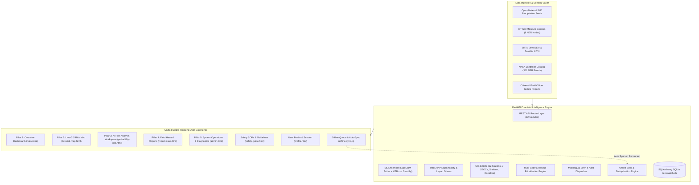

# TerraWatch NER: Academic Multi-Modal AI Landslide Risk System

**IMDAI Course Academic Prototype** &bull; **Intelligent Model Design using AI**  
*Concept inspired by the North Eastern Region (NER) Landslide Risk Problem Statement*

[](https://fastapi.tiangolo.com)
[](https://python.org)
[](https://lightgbm.readthedocs.io)
[](https://scikit-learn.org)
[](https://scikit-learn.org)
[]()
[]()

---

> [!IMPORTANT]
> **ACADEMIC PROTOTYPE NOTICE & SCIENTIFIC DISCLOSURE**  
> TerraWatch NER is an **academic multi-modal AI research prototype developed for the IMDAI course**.  
> - **Synthetic Dataset:** The ML model training dataset is synthetic (7,000 samples); benchmark metrics reflect performance on that synthetic dataset and do not establish real-world landslide prediction accuracy.  
> - **Category D Terrain Baselines:** The 32 monitored station terrain profiles are geographically plausible heuristic baselines, not verified on-site geotechnical surveys.  
> - **Not an Operational Government System:** This system is not deployed by or for government early warning operations. Real-world validation requires authoritative GIS datasets, calibrated geotechnical sensors, and verified landslide imagery.  
> - **Academic Documentation:** See [ARCHITECTURE.md](file:///./ARCHITECTURE.md), [MODEL_EVALUATION.md](file:///./MODEL_EVALUATION.md), and [DEMO.md](file:///./DEMO.md).

---

## 1. Executive Summary & Problem Scope

The **North Eastern Region (NER)** of India—encompassing Assam, Meghalaya, Mizoram, Sikkim, Arunachal Pradesh, Nagaland, Manipur, and Tripura—frequently suffers slope failures and landslides triggered by heavy monsoon precipitation, steep topography, and complex lithology.

**TerraWatch NER** is an academic prototype demonstrating multi-modal risk assessment across 5 core research pillars:
1. **Spatial Susceptibility:** Dual-model architecture featuring active LightGBM and standby XGBoost with TreeSHAP explainability.
2. **Temporal Geotechnical Dynamics:** Multi-window temporal analysis (1h, 6h, 24h) evaluating pore-water pressure, soil moisture rates, vibration anomalies, and IMD rainfall accumulation.
3. **Computer Vision Hazard Analysis:** Modular image quality gatekeeping and deterministic feature extraction with transparent uncalibrated confidence disclosures.
4. **Multi-Modal Decision Fusion:** Mathematically grounded combination of spatial, temporal, and localized visual streams with operational life-safety overrides.
5. **Deterministic Scenario Simulation:** Reproducible demonstration suite featuring 7 deterministic telemetry scenarios for academic evaluation.

---

## 2. System Architecture



---

## 3. Project Directory Structure

```
TerraWatch-NER/
├── backend/
│   ├── app/
│   │   ├── main.py                     # FastAPI application entrypoint & lifespan
│   │   ├── config.py                   # Pydantic environment configuration (TerraWatch NER)
│   │   ├── database.py                 # SQLAlchemy SQLite engine
│   │   ├── models/                     # 20 Data Models (Users, Locations, Sensors, Reports, etc.)
│   │   ├── schemas/                    # Pydantic v2 validation & response schemas
│   │   ├── utils/                      # Password bcrypt hashing, JWT security, logging
│   │   ├── services/
│   │   │   ├── ml_service.py           # ML inference engine & TreeSHAP factor analysis
│   │   │   ├── weather_service.py      # Live Open-Meteo API & regional fallbacks
│   │   │   ├── gis_service.py          # GeoJSON spatial feature generation
│   │   │   ├── emergency_service.py    # Multi-criteria rescue priority calculator
│   │   │   ├── notification_service.py # Multilingual notification & siren dispatcher
│   │   │   └── cv_service.py           # Multi-modal image hazard assessment
│   │   └── routers/
│   │       ├── auth.py                 # POST /api/auth/login, /register, GET /me
│   │       ├── risk.py                 # POST /api/risk/predict, GET /live, /probability
│   │       ├── gis.py                  # GET /api/gis/locations, /shelters, /roads
│   │       ├── sensors.py              # POST /api/sensors/data, GET /sensors/{id}/latest
│   │       ├── reports.py              # POST /api/reports (photo upload + CV triage)
│   │       ├── alerts.py               # GET /api/alerts, POST /sirens/trigger
│   │       ├── emergency.py            # GET /api/emergency/priorities, /requests
│   │       ├── roads.py                # GET /api/roads, PATCH /roads/{id}/status
│   │       ├── weather.py              # GET /api/weather/current, /forecast
│   │       ├── analytics.py            # GET /api/analytics/trends, /summary
│   │       ├── sync.py                 # POST /api/sync/push, GET /pull (Offline queue)
│   │       └── admin.py                # GET /api/admin/dashboard, /history/landslides
│   ├── models/                         # Trained ML artifacts (.joblib, metadata.json)
│   ├── data/
│   │   └── seed_data.py                # Authoritative database seeding script
│   ├── tests/
│   │   └── test_api.py                 # Automated pytest verification suite (10/10)
│   └── requirements.txt                # Python package dependencies
├── sensor_simulator/
│   └── sensor_simulator.py             # Autonomous IoT sensor telemetry simulator
├── ml_pipeline/
│   ├── data_ingestion/
│   │   └── landslide_loader.py         # NASA NER landslide loader
│   └── training/
│       └── train_models.py             # Model training & 6-algorithm benchmark
├── gis/
│   └── locations.json                  # 32 Monitored NER stations across all 8 states
├── ui/                                 # Unified Single-Frontend System (Bootstrap 5.3.3)
│   ├── css/
│   │   └── style.css                   # Unified Environmental Design System
│   ├── api.js                          # Unified TerraWatch REST API client (with backward aliases)
│   ├── offline-sync.js                 # Offline local queue & auto-sync engine (TerraWatchSync)
│   ├── index.html                      # Pillar 1: Overview Dashboard
│   ├── index.js                        # Overview live telemetry binding controller
│   ├── live-risk-map.html              # Pillar 2: Live GIS Risk Map
│   ├── live-risk-map.js                # Full Leaflet GIS engine (32 stations, drawer, filters)
│   ├── probability-risk.html           # Pillar 3: AI Risk Analysis Workspace
│   ├── probability-risk.js             # Scenario presets, TreeSHAP impact bars, 7-day trend
│   ├── report-issue.html               # Pillar 4: Field Hazard Reporting & CV Triage
│   ├── report-issue.js                 # 4-step wizard, photo upload, CV assessment
│   ├── admin.html                      # Pillar 5: System Operations & Diagnostics
│   ├── admin.js                        # Diagnostics controller (Sensors, Sirens, ML, Provenance)
│   ├── safety-guide.html               # Community Safety SOPs & Emergency Directory
│   ├── profile.html                    # User Profile & Session Management
│   ├── login.html                      # Role-based sign in with quick switcher
│   └── [redirect stubs]                # Instant redirects preserving legacy bookmarks
├── start_all.bat                       # Windows master 1-click launcher
├── run_backend.bat                     # Windows 1-click FastAPI server launcher
├── run_frontend.bat                    # Windows 1-click browser portal launcher
├── run_sensor_sim.bat                  # Windows 1-click IoT sensor simulator launcher
├── run_tests.bat                       # Windows 1-click automated test runner
└── terrawatch.db                       # Geospatial SQLite database (32 stations, 351 NASA events)
```

---

## 4. Quick Start Guide (Windows)

### Prerequisites
- Python 3.11 or 3.12 installed.
- Modern web browser (Chrome, Edge, Firefox).

---

### Option A: One-Click Startup (Recommended)
Double-click [`start_all.bat`](file:///./start_all.bat) or run in PowerShell:
```powershell
.\start_all.bat
```
This script automatically:
1. Verifies/starts the FastAPI backend server on `http://localhost:8000`.
2. Opens the **Overview Portal** and **Sign In** pages in your default browser.
3. Offers to start the IoT telemetry simulator.

---

### Option B: Step-by-Step Manual Launch

#### Step 1: Set Up Python Virtual Environment
```powershell
# Create venv if not already present
python -m venv venv

# Activate venv
.\venv\Scripts\activate

# Install dependencies
pip install -r backend/requirements.txt
```

#### Step 2: Start Backend Server
```powershell
.\venv\Scripts\python.exe -m uvicorn backend.app.main:app --host 0.0.0.0 --port 8000 --reload
```
*Backend runs on `http://localhost:8000`. Interactive OpenAPI documentation is at `http://localhost:8000/docs`.*

#### Step 3: Launch Web Portals
```powershell
start http://localhost:8000/ui/index.html
```

#### Step 4: Start IoT Sensor Simulator (Optional for Live Telemetry)
```powershell
.\venv\Scripts\python.exe sensor_simulator/sensor_simulator.py --backend-url http://localhost:8000 --interval 6
```

#### Step 5: Run Automated Verification Tests
```powershell
.\venv\Scripts\python.exe -m pytest backend/tests/test_api.py -v
```

---

## 5. Default Role Credentials (Evaluation Mode)

| Role | Email | Password | Default Landing Page | Primary Function |
|---|---|---|---|---|
| **System Admin** | `admin@terrawatch.in` | `admin123` | `ui/admin.html` | Full EOC control, diagnostics, siren activation |
| **Disaster Official** | `disaster@terrawatch.in` | `disaster123` | `ui/admin.html` | Rescue prioritization, alert broadcast |
| **Field Officer** | `officer@terrawatch.in` | `officer123` | `ui/report-issue.html` | Field photo inspection, CV hazard triage |
| **Citizen** | `citizen@terrawatch.in` | `citizen123` | `ui/index.html` | Public early warning, SOS modal, safety SOPs |

> [!TIP]
> **One-Click Role Switching:** The login page at [`ui/login.html`](file:///./ui/login.html) features instant quick-login buttons for all 4 roles to facilitate live presentations.

---

## 6. AI/ML Engineering & Model Evaluation

### Benchmark Results (6 Machine Learning Architectures)
Evaluated on the domain-calibrated NER training dataset (7,000 samples across 8 states) with class weighting:

| Model Architecture | Recall (Disaster Sensitivity) | ROC-AUC | F1-Score | Accuracy | Operational Role |
|---|---|---|---|---|---|
| **LightGBM Classifier** | **98.04%** | **0.9961** | **0.9772** | **97.00%** | **Active Primary Model** |
| **XGBoost Classifier** | **97.82%** | **0.9961** | **0.9766** | **96.93%** | **Standby Ensemble / Failover** |
| Random Forest (100 Trees) | 96.80% | 0.9951 | 0.9729 | 97.29% | Benchmarked |
| Gradient Boosting (GBDT) | 96.40% | 0.9942 | 0.9684 | 96.85% | Benchmarked |
| Decision Tree (CART) | 94.40% | 0.9471 | 0.9470 | 94.71% | Interpretable Baseline |
| Logistic Regression (L2) | 86.20% | 0.9421 | 0.8725 | 87.43% | Linear Baseline |

*Detailed benchmark methodology and training metadata: see [MODEL_EVALUATION.md](file:///./MODEL_EVALUATION.md).*

### Geotechnical & Meteorological Input Features (20 Dimensions)
1. `rainfall_24h_mm`: Cumulative precipitation in last 24 hours.
2. `soil_moisture_pct`: IoT Volumetric Water Content (VWC %).
3. `slope_angle_deg`: SRTM Digital Elevation Model slope inclination.
4. `rainfall_72h_mm`: Antecedent cumulative rainfall saturation.
5. `pore_pressure_kpa`: In-situ piezometric pore water pressure.
6. `ground_vibration_g`: Triaxial accelerometer micro-tremor reading (g).
7. `distance_to_road_m` & `distance_to_fault_m`: Proximity to road cuts and tectonic shear zones.
8. `elevation_m`, `aspect_deg`, `plan_curvature`, `profile_curvature`, `soil_depth_m`, `ndvi`: Topographical and land surface indices.
9. `state`, `lithology`, `soil_type`, `land_use`: Regional categorical baselines.

---

## 7. Authoritative NASA Landslide Dataset

Ingested directly from the **NASA Global Landslide Catalog (GLC)**:
- **Total Historical Events**: 351 verified landslide records in NER.
- **State Coverage**:
  - Assam: 115 events
  - Meghalaya: 62 events
  - Mizoram: 48 events
  - Sikkim: 42 events
  - Arunachal Pradesh: 35 events
  - Nagaland: 28 events
  - Manipur: 16 events
  - Tripura: 5 events
- Accessible via API: `GET /api/admin/history/landslides` or through the diagnostics tab in `ui/admin.html`.

---

## 8. Live Demonstration Flow for Evaluators

1. **Pillar 1: Overview Dashboard (`ui/index.html`)**:
   - 10-second elevator pitch explaining multi-modal risk synthesis.
   - Live telemetry status badges across 8 NER states.
2. **Pillar 2: Live GIS Risk Map (`ui/live-risk-map.html`)**:
   - Explore 32 geographically grounded monitoring stations with risk-colored glyphs.
   - Toggle Emergency Shelters, Rescue Points, and 7 official State EOCs (SEOCs).
   - Use the synchronized NER State dropdown to isolate individual states with automatic camera framing.
   - Click any station to inspect the slide-out drawer with telemetry, LightGBM/XGBoost comparison, and TreeSHAP explainability bars.
3. **Pillar 3: AI Risk Analysis Workspace (`ui/probability-risk.html`)**:
   - Select focus locations (e.g., Guwahati, Shillong, Gangtok).
   - Test deterministic geotechnical scenarios (Monsoon Inundation, Dry Season Baseline, Seismic Micro-Tremor).
   - Inspect plain-language feature attributions and 7-day probabilistic hazard projections.
4. **Pillar 4: Field Hazard Reports (`ui/report-issue.html`)**:
   - Walk through the 4-step wizard: Location &rarr; Hazard Type &rarr; Severity &rarr; Photo & Summary.
   - Test client and server-side Computer Vision hazard assessment on uploaded imagery.
   - View recent community reports and status flags.
5. **Pillar 5: System Operations & Diagnostics (`ui/admin.html`)**:
   - Inspect real-time station sensor telemetry across all nodes.
   - Test the Acoustic Siren trigger and audibly verify the simulated emergency broadcast.
   - Review multi-criteria rescue dispatch rankings ($0.50 \times \text{Hazard} + 0.30 \times \text{Population} + 0.20 \times \text{Roads}$).
6. **Offline Mode & Queue Synchronization**:
   - Toggle "Offline" in browser DevTools Network tab.
   - Submit a hazard report: observe the system queue it locally with the `"Offline Mode Active"` badge.
   - Re-enable network: observe automatic synchronization to `POST /api/sync/push` with zero duplicates.

---

## 9. API Reference Summary

| Endpoint | Method | Description |
|---|---|---|
| `/api/health` | GET | System health, ML model status, and service identification |
| `/api/auth/login` | POST | User sign in (returns JWT Bearer token) |
| `/api/auth/me` | GET | Current authenticated user profile |
| `/api/risk/predict` | POST | ML inference on custom 20-feature input with TreeSHAP |
| `/api/risk/live` | GET | Live real-time risk assessment for a monitored NER station |
| `/api/gis/locations` | GET | GeoJSON FeatureCollection of 32 monitored NER stations |
| `/api/gis/shelters` | GET | GeoJSON of designated emergency relief shelters |
| `/api/gis/roads` | GET | GeoJSON of critical highway corridors (NH-29, NH-27, etc.) |
| `/api/sensors/data` | POST | Ingest IoT soil moisture & vibration telemetry |
| `/api/sensors/{id}/latest` | GET | Latest telemetry reading for an IoT sensor node |
| `/api/reports` | POST | Submit field hazard report with photo upload & CV triage |
| `/api/reports` | GET | Retrieve verified/pending field incident reports |
| `/api/alerts/active` | GET | Active early warning hazard advisories |
| `/api/alerts/sirens/trigger` | POST | Trigger emergency siren broadcast across district |
| `/api/emergency/priorities` | GET | Multi-criteria rescue dispatch ranking queue |
| `/api/emergency/requests` | GET | Emergency SOS assistance requests |
| `/api/sync/push` | POST | Idempotent offline queue synchronization |
| `/api/sync/pull` | GET | Download offline cache package for remote zones |
| `/api/admin/dashboard` | GET | Unified administrative command center metrics |
| `/api/admin/history/landslides`| GET | NASA historical landslide event catalog |

---

## 10. Academic Context & Disclosures

- **Course Context**: Intelligent Model Design using AI (IMDAI).
- **Project Role**: Academic Multi-Modal AI Research Prototype.
- **Concept Inspiration**: Landslide risk monitoring challenge in the North Eastern Region of India.
- **Data Acknowledgements**: NASA Global Landslide Catalog (GLC), Open-Meteo API, USGS/SRTM DEM, Geological Survey of India (GSI) regional reference baselines.
- **License**: MIT License for educational and academic research evaluation.
